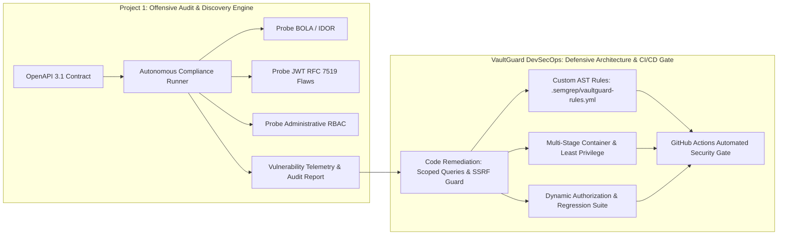
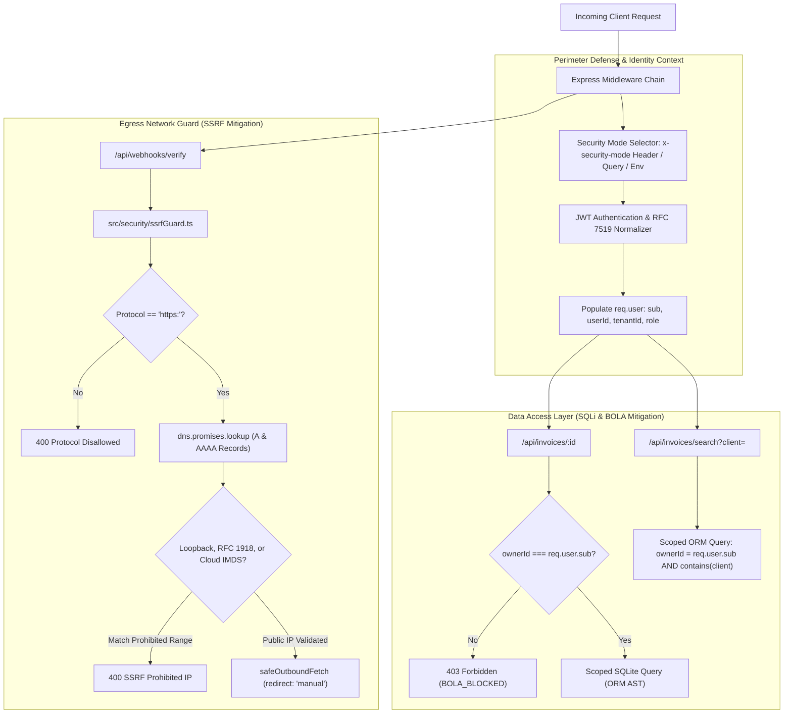
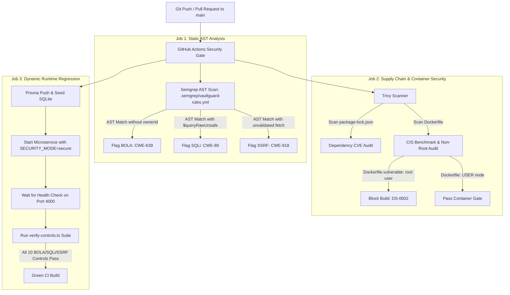

# VaultGuard DevSecOps: Architecture & Security Engineering Specification

VaultGuard DevSecOps is a high-assurance fintech microservice and security pipeline designed to demonstrate enterprise Application Security, DevSecOps automation, and Cloud-Native Defense-in-Depth.

---

## 1. Purple Team Engineering Lifecycle: The Two-Repository Ecosystem

This project forms the defensive and automation counterpart to our **API Security Audit Engine (`Project-1`)**:



### Full-Lifecycle Workflow
1. **Discovery (Project-1):** An automated compliance engine parses OpenAPI specifications, launches deterministic role-swapping payloads, and discovers Broken Object Level Authorization (CWE-639), Broken Function Level Authorization (CWE-285), and weak token hygiene.
2. **Defensive Remediation (`vaultguard-devsecops`):** Engineering teams implement AST-level parameterization, tenant-joined ORM constraints, and egress network isolation (`ssrfGuard.ts`).
3. **Continuous Enforcement (`vaultguard-devsecops` CI/CD):** Custom Semgrep rules and Trivy container audits act as static and IaC gates, while dynamic regression tests assert multi-tenant isolation on every Git commit.

---

## 2. Threat Modeling & Security Controls



### Threat 1: Multi-Tenant Data Leakage (CWE-639 BOLA / IDOR)
- **Vector:** An authenticated merchant modifies the document identifier in `GET /api/invoices/103` to retrieve an invoice owned by a competing merchant.
- **Control:** The database query eliminates single-attribute lookups (`where: { id }`). The query boundary requires a composite predicate joining primary key with caller identity:
  ```typescript
  await prisma.invoice.findFirst({
    where: { id, ownerId: req.user.sub }
  });
  ```

### Threat 2: SQL Injection & Grammar Mutation (CWE-89)
- **Vector:** An attacker sends `%' OR '1'='1` in the `client` parameter, intending to alter the query AST disjunction to return all invoices.
- **Control:** Replaces raw string concatenation (`$queryRawUnsafe`) with type-safe Prisma ORM queries. Parameters are bound out-of-band to SQLite virtual machine registers, neutralizing SQL syntax mutation.

### Threat 3: Server-Side Request Forgery & Cloud Credential Theft (CWE-918)
- **Vector:** An attacker submits `http://169.254.169.254/latest/meta-data/` to compromise AWS/GCP instance metadata credentials, or `http://127.0.0.1:4000/api/...` to bypass perimeter firewalls.
- **Control:** `src/security/ssrfGuard.ts` enforces:
  1. Scheme pinning (`https:` only).
  2. Complete DNS resolution over all `A` and `AAAA` records.
  3. Bitwise CIDR blocking against `127.0.0.0/8`, `10.0.0.0/8`, `172.16.0.0/12`, `192.168.0.0/16`, `169.254.0.0/16`, `::1`, and `fe80::/10`.
  4. Manual redirect enforcement (`redirect: 'manual'`) to neutralize TOCTOU DNS rebinding pivots.

---

## 3. Automated DevSecOps Gate Architecture

Our GitHub Actions pipeline executes three automated gates:



---

## 4. Dual-Mode Architecture & Precedence

The application features a deterministic runtime toggle:
1. **HTTP Request Header:** `x-security-mode: vulnerable | secure` (highest priority).
2. **URL Query Parameter:** `?mode=vulnerable | secure`.
3. **Environment Variable:** `SECURITY_MODE=vulnerable | secure` (fallback).

This allows developers, security auditors, and automated CI pipelines to test both vulnerable behavior (vulnerability reproduction) and patched behavior (compliance verification) within the same deployment.
