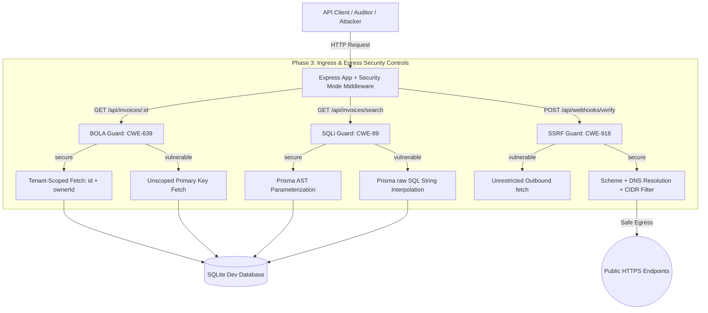
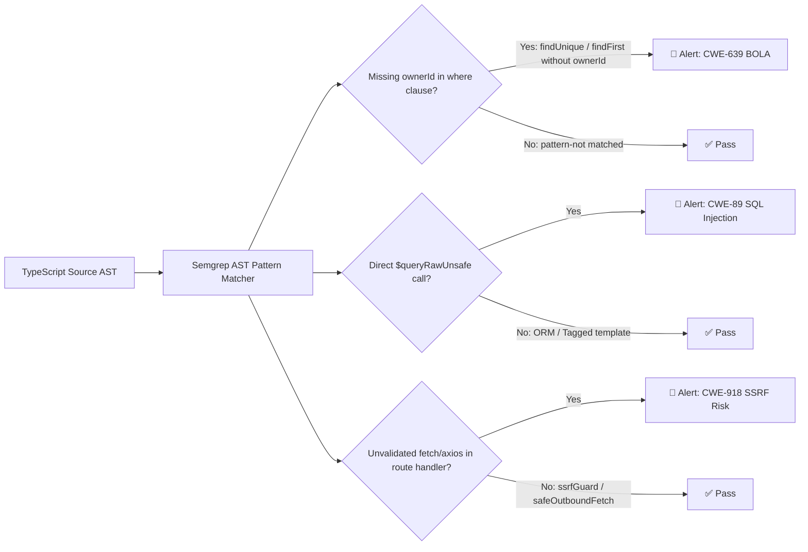

# VaultGuard DevSecOps: Secure Architecture, Injection & Outbound Network Controls

VaultGuard DevSecOps is an enterprise-grade fintech microservice built to demonstrate DevSecOps controls, application security architecture, and automated CI/CD security gates.

This repository covers **Phase 3 (Injection & Outbound Network Controls)**, **Phase 5 (Custom Semgrep SAST Rules & Trivy Container Hardening)**, and **Phase 6 (Automated GitHub Actions CI/CD Security Gate)**.

---

## 🏛️ System Architecture & Phase Scope



---

## 🔬 Security Theory Deep-Dive

### 1. Abstract Syntax Tree (AST) & Driver-Level SQL Parameterization (CWE-89)

#### The Lexical & AST Breakdown
When a relational database engine processes an incoming query string, it executes three discrete stages:
1. **Lexical Analysis (Scanning):** Deconstructs the input text stream into terminal tokens (`SELECT`, `FROM`, identifiers, string literals, operators).
2. **Parsing & AST Construction:** Assembles tokens into an Abstract Syntax Tree representing the hierarchical grammar of the relational algebra.
3. **Compilation & Query Plan Generation:** Generates the relational execution plan and byte-code routines executed by the database virtual machine.

#### Why String Interpolation Fails
In vulnerable raw queries:
```typescript
const query = `SELECT * FROM "Invoice" WHERE "description" LIKE '%${client}%'`;
await prisma.$queryRawUnsafe(query);
```
An attacker supplying `client = %' OR '1'='1` causes the lexical scanner to yield the tokens `OR`, `'1'`, `=`, `'1'`. This mutates the grammar tree itself, injecting an always-true boolean disjunction at the AST level and returning records across all tenants.

#### Driver-Level Parameterization
In parameterized queries:
```typescript
const invoices = await prisma.invoice.findMany({
  where: {
    ownerId: req.user.sub,
    description: { contains: client },
  },
});
```
The database engine compiles the static AST and assigns register slots for parameters (`?1`, `$1`) *prior* to parameter binding. The parameter payload is transmitted separately as pure scalar datum. The database parser never encounters user input during grammar construction, mathematically neutralizing SQL syntax injection regardless of payload complexity.

---

### 2. DNS-Level SSRF Defenses & DNS Rebinding TOCTOU (CWE-918)

#### The Egress Threat Vector
Server-Side Request Forgery occurs when a server initiates outbound HTTP requests to attacker-controlled destinations. In modern cloud and container architectures, this enables attackers to pivot into:
- **Cloud Instance Metadata (IMDS):** AWS/GCP/Azure link-local endpoints (`169.254.169.254`) exposing IAM credentials and bootstrap scripts.
- **Loopback Services:** `127.0.0.1`, `[::1]`, accessing internal administrative ports, metrics, or debug bridges.
- **Private RFC 1918 Subnets:** `10.0.0.0/8`, `172.16.0.0/12`, `192.168.0.0/16` hosting internal databases, microservices, and caches.

#### Why URL String Validation Fails
Blacklisting string patterns (e.g. `!url.includes('localhost')`) is easily bypassed using:
- Alternative IP notations: Octal (`0177.0.0.1`), Hex (`0x7f000001`), Dword integer (`2130706433`).
- IPv6 representations: IPv4-mapped IPv6 (`::ffff:127.0.0.1`), IPv6 loopback (`[::1]`).
- DNS aliasing: Attacker-controlled domains resolving to loopback (`127.0.0.1.nip.io`).

#### Defensive Egress Controls Implemented in `src/security/ssrfGuard.ts`
1. **Scheme Pinning:** Enforces strict `https:` scheme; blocks `http:`, `file:`, `gopher:`, `ftp:`.
2. **Comprehensive DNS Resolution:** Uses `dns.promises.lookup(hostname, { all: true })` to inspect all `A` and `AAAA` records returned by upstream resolvers.
3. **CIDR Boundary Enforcement:** Blocks all addresses within:
   - Loopback: `127.0.0.0/8`, `::1`
   - RFC 1918 Private Ranges: `10.0.0.0/8`, `172.16.0.0/12`, `192.168.0.0/16`
   - Cloud Metadata / Link-Local: `169.254.0.0/16`, `fe80::/10`
   - Carrier-Grade NAT: `100.64.0.0/10`
   - Unique Local IPv6: `fc00::/7`
4. **DNS Rebinding (TOCTOU) & Redirect Mitigation:**
   - Attackers deploy nameservers with `TTL=0` that return a public IP during pre-flight lookup, then resolve to `169.254.169.254` during the subsequent HTTP fetch.
   - Guard mitigation: HTTP requests use `redirect: 'manual'` to prevent redirect-based pivot attacks, and disallow blind redirect traversal to internal networks.

---

## 🛠️ API Specification

| Endpoint | Method | Vulnerability / Control | Header Toggle | Description |
|---|---|---|---|---|
| `/api/invoices/:id` | `GET` | CWE-639 BOLA | `x-security-mode` | Multi-tenant invoice retrieval by primary key |
| `/api/invoices/search` | `GET` | CWE-89 SQL Injection | `x-security-mode` | Search invoices by client description |
| `/api/webhooks/verify` | `POST` | CWE-918 SSRF | `x-security-mode` | Merchant webhook reachability validator |
| `/api/test-setup/tokens` | `GET` | Auth Utility | None | Issues deterministic JWTs for Alice, Bob, Admin |
| `/api/health` | `GET` | Monitoring | None | Health check and active security mode display |

---

## 🧪 Local Verification & Compliance Testing

Run the automated integration verification suite:
```bash
# Setup database schema and seed deterministic personas
npm run db:setup

# Execute verification suite against all controls
npm run test:controls
```

### Verification Suite Results
```text
======================================================================
🛡️  VaultGuard DevSecOps - Phase 3 Controls Verification Suite
    Validating CWE-639 (BOLA), CWE-89 (SQLi), and CWE-918 (SSRF)
======================================================================

--- [SUITE 1: CWE-639 BOLA / IDOR Verification] ---
  ✅ PASS [CWE-639 BOLA] Vulnerable mode allows cross-tenant invoice access - Status: 200, Leaked Invoice #103 Owner: user_bob, TaxId: US-TAX-BOB-9921
  ✅ PASS [CWE-639 BOLA] Secure mode rejects cross-tenant invoice access - Status: 403, Code: BOLA_BLOCKED, Error: Access Denied: Object-level authorization policy violation (CWE-639 BOLA blocked)
  ✅ PASS [CWE-639 BOLA] Secure mode allows legitimate resource owner access - Status: 200, Invoice #101 Amount: $1450

--- [SUITE 2: CWE-89 SQL Injection Verification] ---
  ✅ PASS [CWE-89 SQLi] Vulnerable mode executes raw string interpolation and leaks cross-tenant records - Returned 3 invoices across all tenants (Bob invoice leaked: true)
  ✅ PASS [CWE-89 SQLi] Secure mode parameterizes query and enforces tenant isolation - Returned 0 invoices (Bob invoice leaked: false). Payload treated as literal scalar.

--- [SUITE 3: CWE-918 Server-Side Request Forgery Verification] ---
  ✅ PASS [CWE-918 SSRF] Blocks insecure HTTP scheme and loopback (http://127.0.0.1) - Status: 400, Code: PROTOCOL_DISALLOWED, Reason: SSRF Guard Rejection: Insecure protocol 'http:'. Only strict 'https:' is permitted.
  ✅ PASS [CWE-918 SSRF] Blocks link-local cloud metadata service (169.254.169.254) - Status: 400, Code: PROTOCOL_DISALLOWED
  ✅ PASS [CWE-918 SSRF] Blocks RFC 1918 Private IP address (10.0.0.1) via SSRF Guard - Valid: false, Code: SSRF_PROHIBITED_IP, Error: SSRF Blocked: Target resolves to prohibited network range (10.0.0.1 - RFC 1918 Private Network (10.0.0.0/8))
  ✅ PASS [CWE-918 SSRF] Blocks IPv6 Loopback address (::1) via SSRF Guard - Valid: false, Code: SSRF_PROHIBITED_IP, Error: SSRF Blocked: Target resolves to prohibited network range (::1 - IPv6 Loopback address (::1))
  ✅ PASS [CWE-918 SSRF] Permits legitimate public HTTPS webhook endpoint - Valid: true, Resolved IPs: 172.66.147.243, 104.20.23.154, 2606:4700:10::6814:179a, 2606:4700:10::ac42:93f3

======================================================================
📊 Verification Complete: 10/10 Checks Passed (0 Failures)
======================================================================
✨ All security controls and regression tests passed successfully!
```

---

## 🛡️ Phase 5: Custom Semgrep SAST & Trivy Container Hardening

### 1. Custom Semgrep SAST Rules (`.semgrep/vaultguard-rules.yml`)

Our custom Semgrep rule suite implements 3 targeted AST inspection rules mapped to OWASP and CWE classifications:



#### How `pattern` and `pattern-not` Eliminate False Positives
Traditional regex-based grep tools cannot understand programming language syntax: they match words inside comments, string literals, and variable names alike. Semgrep parses source files into an Abstract Syntax Tree (AST), enabling semantic pattern matching.

In **Rule 1 (`vaultguard-prisma-missing-owner-id`)**:
```yaml
patterns:
  - pattern-either:
      - pattern: $PRISMA.invoice.findUnique({ ... })
      - pattern: $PRISMA.invoice.findFirst({ ... })
  - pattern-not: |
      $PRISMA.invoice.$METHOD({
        where: {
          ...,
          ownerId: $OWNER,
          ...
        },
        ...
      })
```
- `pattern-either` identifies all invocations of invoice primary key / object lookups across the codebase.
- `pattern-not` acts as an AST-level filter: if the AST contains an object literal inside `where` with the key `ownerId: $OWNER`, Semgrep automatically discards the finding.
- **Result:** Legitimate multi-tenant lookups (`prisma.invoice.findFirst({ where: { id, ownerId: req.user.sub } })`) produce **zero false positives**, while unscoped lookups are immediately flagged.

---

### 2. Container Hardening: `Dockerfile.vulnerable` vs `Dockerfile`

| Security Dimension | `Dockerfile.vulnerable` (Anti-Pattern) | `Dockerfile` (Hardened Production) |
|---|---|---|
| **Base Image** | `node:18` (Bloated Debian base, ~1GB, full OS packages) | `node:20-alpine` (Minimal Alpine base, ~180MB, minimal CVE surface) |
| **Execution User** | `root` (UID 0 - full host kernel capability mapping) | `USER node` (UID 1000 - non-root, principle of least privilege) |
| **Build Architecture** | Single-stage (compilers, npm cache, devDeps left in image) | Multi-stage (`builder` -> `runner` with `npm prune --production`) |
| **Context Hygiene** | No `.dockerignore` (copies `.env`, `.git`, local `dev.db`) | Strict `.dockerignore` (excludes secrets, git history, volatile DBs) |
| **Health Monitoring** | None (orchestrator cannot detect hung processes) | `HEALTHCHECK` with periodic non-root endpoint probe |
| **Process Management** | Node as PID 1 (zombie processes, improper signal forwarding) | `dumb-init` (proper signal forwarding and PID 1 zombie reaping) |

---

### 3. Local Security Scan Execution

Run all Phase 5 security audits locally:
```bash
# 1. Run Semgrep Custom AST SAST Rules
npm run scan:sast

# 2. Run Trivy Container Misconfiguration Scan
npm run scan:trivy

# 3. Run Full Security Orchestration Suite (SAST + Trivy Config + Secret + FS)
npm run scan:all
```

#### Trivy Audit Findings Summary
```text
Report Summary
┌───────────────────────┬────────────┬───────────────────┐
│        Target         │    Type    │ Misconfigurations │
├───────────────────────┼────────────┼───────────────────┤
│ Dockerfile            │ dockerfile │         0         │  <-- Clean production image
├───────────────────────┼────────────┼───────────────────┤
│ Dockerfile.vulnerable │ dockerfile │         2         │  <-- Flags DS-0002 (root user) & DS-0026 (missing healthcheck)
└───────────────────────┴────────────┴───────────────────┘
```

