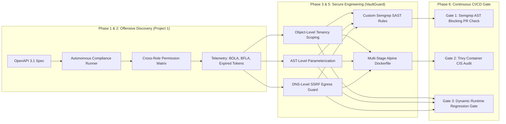
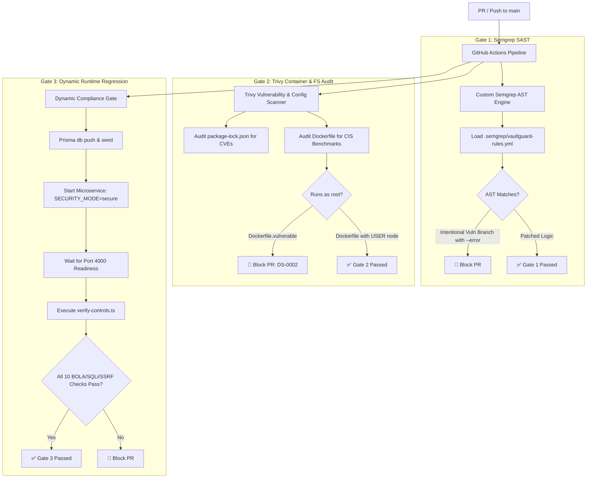

# VaultGuard DevSecOps: Secure Architecture, Custom SAST & Automated CI/CD Security Gate

[](.github/workflows/security-gate.yml)
[](.semgrep/vaultguard-rules.yml)
[](Dockerfile)
[](tsconfig.json)
[](prisma/schema.prisma)

---

## 📌 Executive Summary: The Full-Lifecycle Purple Team Architecture

In production cloud environments, security cannot exist solely as an offensive penetration testing report or an isolated set of CI lint rules. True DevSecOps requires a closed-loop **Purple Team Lifecycle**:



1. **Offensive Discovery (`Project-1` / `auth-matrix`):** Our autonomous security scanner probes target APIs using matrix-based role-swapping payloads, programmatically demonstrating authorization bypasses (CWE-639 BOLA) and administrative escalation (CWE-285 BFLA).
2. **Defensive Remediation (`vaultguard-devsecops`):** We engineer an enterprise fintech microservice implementing multi-tenant data access boundaries, AST-level SQL query parameterization, and deep network egress controls (`ssrfGuard.ts`).
3. **Automated Guardrails (`vaultguard-devsecops` CI/CD):** We translate vulnerability patterns into custom Semgrep AST rules and Trivy container policies that automatically block regressions at the GitHub Actions pull request stage.

---

## 🛡️ Vulnerability & Remediation Matrix

| Endpoint | Vulnerability / Threat | OWASP Category | CWE | Vulnerable Pattern | Patched Production Pattern | Automated Gate |
|---|---|---|---|---|---|---|
| `GET /api/invoices/:id` | Broken Object Level Authorization (BOLA / IDOR) | OWASP API1:2023 | CWE-639 | `prisma.invoice.findUnique({ where: { id } })` (omits tenant filter) | `prisma.invoice.findFirst({ where: { id, ownerId: req.user.sub } })` | **Semgrep:** `vaultguard-prisma-missing-owner-id`<br>**Dynamic:** `verify-controls.ts` (Asserts 403 on cross-tenant access) |
| `GET /api/invoices/search` | SQL Injection (Grammar Mutation) | OWASP A03:2021<br>API8:2023 | CWE-89 | Raw string interpolation in `prisma.$queryRawUnsafe("... LIKE '%" + client + "%'")` | AST parameterization via Prisma ORM: `where: { ownerId, description: { contains: client } }` | **Semgrep:** `vaultguard-prisma-raw-sql-unsafe`<br>**Dynamic:** `verify-controls.ts` (Injects `' OR '1'='1`) |
| `POST /api/webhooks/verify` | Server-Side Request Forgery (SSRF) | OWASP A10:2021<br>API7:2023 | CWE-918 | Direct unvalidated `fetch(targetUrl)` allowing egress to internal hosts | Centralized `src/security/ssrfGuard.ts`: Scheme enforcement, canonical DNS resolution, CIDR blocking | **Semgrep:** `vaultguard-unvalidated-ssrf-fetch`<br>**Dynamic:** `verify-controls.ts` (Blocks `127.0.0.1` and `169.254.169.254`) |
| `Dockerfile` | Container Privilege Escalation | CIS Docker Benchmark | CWE-250 | Single-stage build executing as `root` (UID 0) without health monitoring | Multi-stage build on `node:20-alpine`, `USER node` (UID 1000), `dumb-init` PID 1, and `HEALTHCHECK` | **Trivy:** `trivy config` fails on `DS-0002` (missing non-root user) |

---

## 🔬 Security Engineering Deep-Dive

### 1. Abstract Syntax Tree (AST) vs. String Interpolation (CWE-89)
Relational databases parse input through lexical scanners that assemble an Abstract Syntax Tree (AST). In vulnerable code:
```typescript
const query = `SELECT * FROM "Invoice" WHERE "description" LIKE '%${client}%'`;
await prisma.$queryRawUnsafe(query);
```
Passing `client = %' OR '1'='1` breaks out of the string literal, injecting `OR` and `=` operators into the grammar tree prior to compilation. The AST's boolean disjunction is mutated to always evaluate to `TRUE`, exfiltrating cross-tenant invoices.

In our patched implementation:
```typescript
const invoices = await prisma.invoice.findMany({
  where: {
    ownerId: req.user.sub,
    description: { contains: client },
  },
});
```
The query AST is statically compiled with parameter placeholders (`?1`). User input is bound out-of-band to SQLite registers as pure scalar data. The database parser never encounters user input during grammar construction, neutralizing injection attempts regardless of payload structure.

---

### 2. DNS-Level SSRF Egress Defense & DNS Rebinding (CWE-918)
In cloud environments, unrestricted outbound HTTP requests expose cloud instance metadata (`169.254.169.254`), container APIs, and loopback services. String blacklists fail against alternative IP formats (e.g. `0177.0.0.1`, `2130706433`, `[::ffff:127.0.0.1]`).

Our centralized guard in [`src/security/ssrfGuard.ts`](src/security/ssrfGuard.ts) enforces:
1. **Strict Scheme Pinning:** Only `https:` is permitted (rejects `http:`, `file:`, `gopher:`).
2. **Comprehensive DNS Resolution:** Resolves all canonical `A` and `AAAA` records using `dns.promises.lookup(host, { all: true })`.
3. **CIDR Boundary Enforcement:** Blocks all private and cloud metadata address spaces:
   - Loopback: `127.0.0.0/8`, `::1`
   - RFC 1918 Private Ranges: `10.0.0.0/8`, `172.16.0.0/12`, `192.168.0.0/16`
   - Cloud IMDS & Link-Local: `169.254.0.0/16`, `fe80::/10`
   - Carrier-Grade NAT: `100.64.0.0/10`
   - Unique Local IPv6: `fc00::/7`
4. **DNS Rebinding & Redirect Defense:** Disables automatic redirect traversal (`redirect: 'manual'`) to prevent attackers from bouncing verified domains to internal metadata IPs.

---

## ⚙️ CI/CD Pipeline Architecture (`.github/workflows/security-gate.yml`)

The pipeline runs three concurrent gates on every `push` and `pull_request` to `main`:



---

## 🚀 How to Demo a Failing vs. Passing Pull Request

This repository is purpose-built to visually demonstrate automated security gates blocking regressions:

### Demo Scenario A: Triggering Gate 2 (Container Non-Root Failure)
1. In a pull request, change the Dockerfile target in [`.github/workflows/security-gate.yml`](.github/workflows/security-gate.yml) from `Dockerfile` to `Dockerfile.vulnerable` (or use GitHub Actions `workflow_dispatch` with `target_dockerfile: Dockerfile.vulnerable`).
2. **Result:** Job `trivy-scan` immediately halts the build with exit code 1:
   ```text
   FAILURES: 2 (HIGH: 1, LOW: 1)
   DS-0002 (HIGH): Specify at least 1 USER command in Dockerfile with non-root user as argument
   See https://avd.aquasec.com/misconfig/ds-0002
   Error: Process completed with exit code 1.
   ```
3. Switching back to the production `Dockerfile` passes the gate with **0 misconfigurations**.

### Demo Scenario B: Triggering Gate 3 (Authorization Regression Failure)
1. In a pull request, change the environment variable in [`.github/workflows/security-gate.yml`](.github/workflows/security-gate.yml) from `SECURITY_MODE=secure` to `SECURITY_MODE=vulnerable`.
2. **Result:** Job `dynamic-compliance-gate` runs the test suite against the service. Because the service is running in vulnerable mode, Alice is permitted to access Bob's invoice `#103`.
3. The compliance runner detects the BOLA authorization failure and exits with `process.exit(1)`, failing the GitHub Actions check.

### Demo Scenario C: Triggering Gate 1 (Custom AST SAST Violation)
1. Run Semgrep locally with the blocking flag:
   ```bash
   semgrep scan --config .semgrep/vaultguard-rules.yml src/ --error
   ```
2. **Result:** Semgrep flags the intentional vulnerable route implementations (`vaultguard-prisma-raw-sql-unsafe`, `vaultguard-prisma-missing-owner-id`, and `vaultguard-unvalidated-ssrf-fetch`) and returns exit code 1.

---

## 💻 Local Developer & Auditor Setup

### 1. Database Setup & Seeding
```bash
# Push Prisma schema and seed deterministic personas (Alice, Bob, Admin)
npm run db:setup
```

### 2. Run Dynamic Runtime Compliance Tests
```bash
# Executes 10-point authorization, SQLi, and SSRF verification suite
npm run test:controls
```

### 3. Run Static Analysis & Container Audits
```bash
# Run custom Semgrep AST rules
npm run scan:sast

# Run Trivy Dockerfile configuration audit
npm run scan:trivy

# Run full security orchestrator (SAST + Trivy Config + Secrets + FS)
npm run scan:all
```

---

## 📂 Repository Structure

```text
vaultguard-devsecops/
├── .github/workflows/
│   └── security-gate.yml            # Automated 3-job CI/CD Security Pipeline
├── .semgrep/
│   └── vaultguard-rules.yml         # Custom AST rules for BOLA, SQLi, and SSRF
├── prisma/
│   ├── schema.prisma                # Multi-tenant User, Invoice & AuditLog models
│   ├── seed.ts                      # Deterministic test personas & invoices
│   └── dev.db                       # Local SQLite database
├── src/
│   ├── app.ts                       # Express application wiring & middleware
│   ├── server.ts                    # HTTP server listener
│   ├── config/                      # Environment and test persona constants
│   ├── lib/prisma.ts                # PrismaClient singleton
│   ├── middleware/                  # JWT auth, security mode toggle, logger, error handler
│   ├── routes/                      # BOLA (/invoices/:id), SQLi (/invoices/search), SSRF (/webhooks/verify)
│   ├── security/ssrfGuard.ts        # Scheme, DNS resolution & CIDR egress validation
│   └── types/                       # TypeScript declarations
├── tests/
│   └── verify-controls.ts           # 10-point automated compliance verification suite
├── Dockerfile                       # Multi-stage, hardened production Dockerfile (USER node)
├── Dockerfile.vulnerable            # Anti-pattern demonstration Dockerfile (root execution)
├── .dockerignore                    # Strict build context exclusion file
├── trivy.yaml                       # Trivy policy & scanner configuration
├── scripts/run-security-scans.sh    # Multi-scanner local orchestration script
└── ARCHITECTURE.md                  # In-depth architectural & threat modeling specification
```
